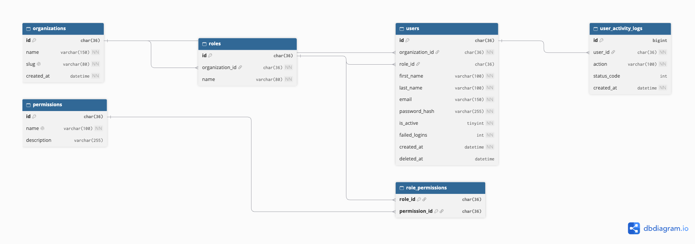

# Entity-Relationship Diagram: lenddesk_users

Database: `lenddesk_users` (users service of the LendDesk platform).
Drawn with dbdiagram.io (or draw.io; change this to the tool you used).

## Entities
| Entity | Purpose |
|---|---|
| organizations | A tenant (lending institution) using the platform |
| users | Staff accounts belonging to one organisation |
| roles | Named sets of permissions, defined per organisation |
| permissions | Individual actions such as `loan:view` |
| role_permissions | Link table assigning permissions to roles |
| user_activity_logs | Record of actions performed by users |

## Relationships
| Relationship | Type | Meaning |
|---|---|---|
| organizations to roles | one-to-many | An organisation defines many roles; each role belongs to one organisation |
| organizations to users | one-to-many | An organisation has many users; each user belongs to one organisation |
| roles to users | one-to-many | A role can be held by many users; a user has at most one role |
| roles to permissions | many-to-many | Resolved through `role_permissions` |
| users to user_activity_logs | one-to-many | A user generates many log entries |

## Notation
Primary keys are marked PK and foreign keys FK. Crow's foot lines show
"many" at the end with the three-pronged symbol.

## Design notes
- `role_permissions` has a composite primary key (role_id, permission_id).
- `role_id` on users is optional, so a user can exist without a role.
- No foreign keys point outside this database, because other services
  (loans, repayments) are separate microservices.
