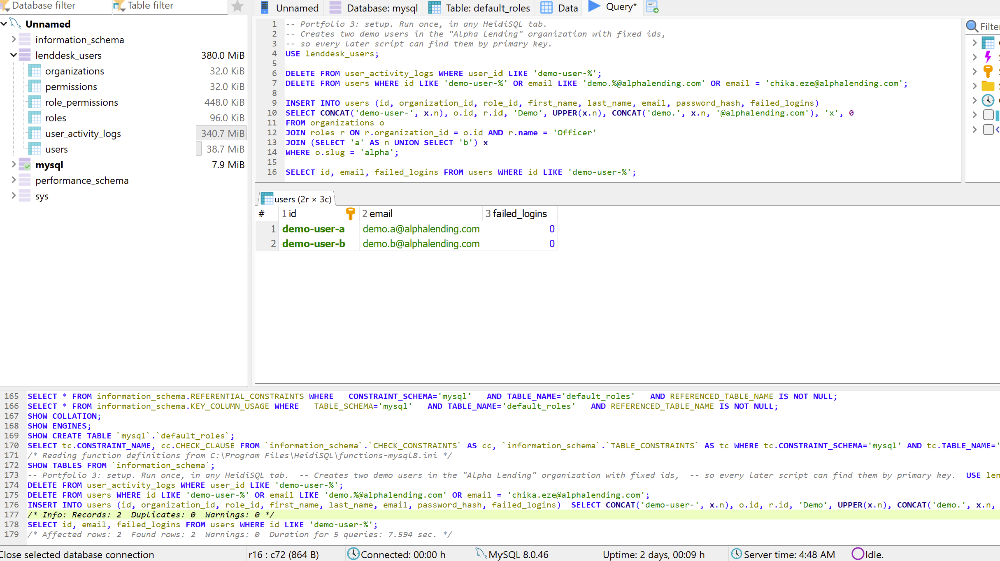
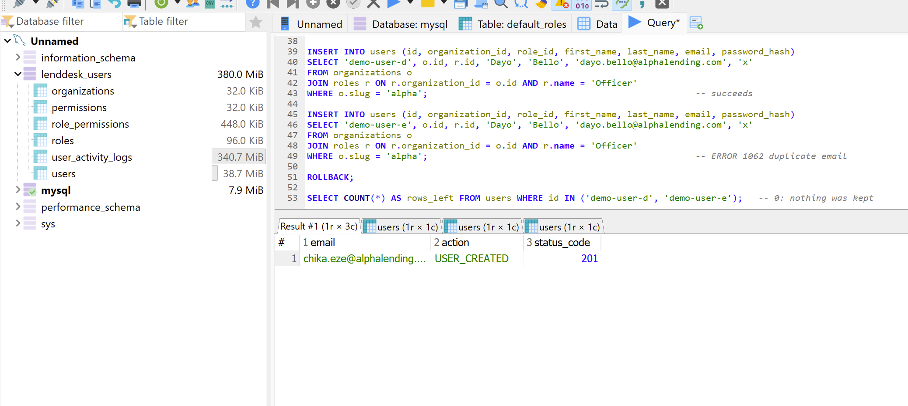
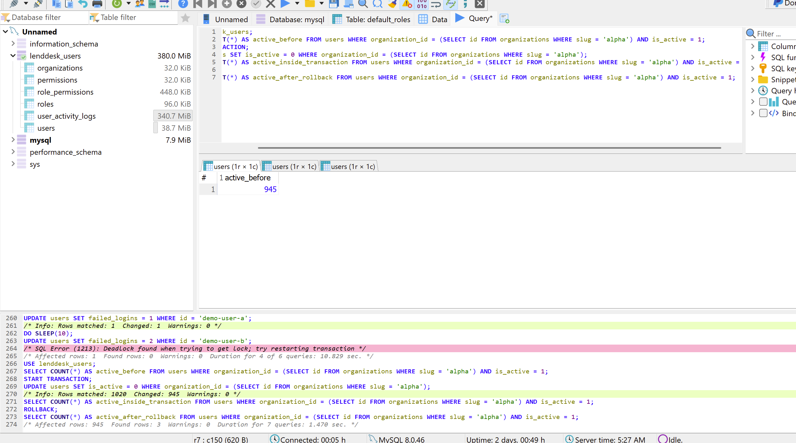
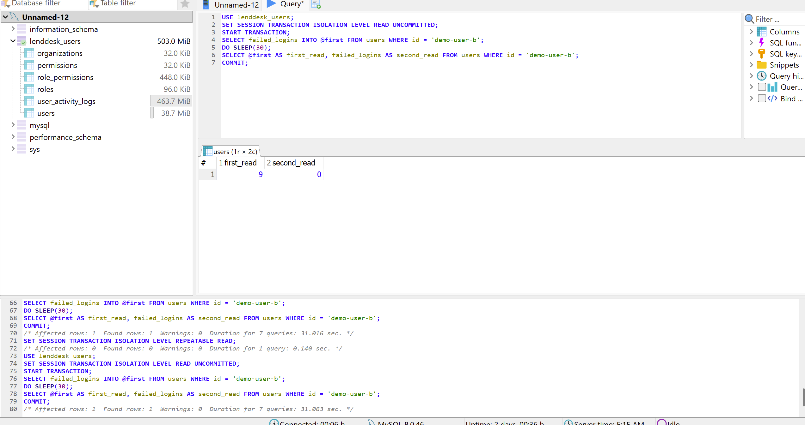
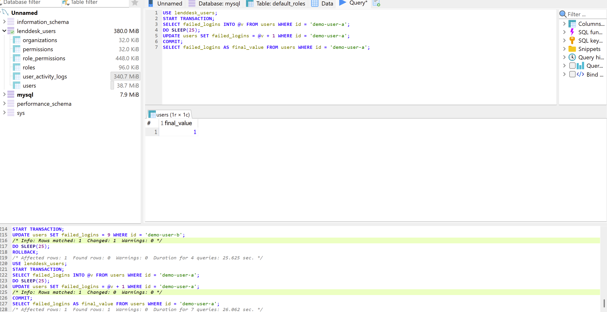
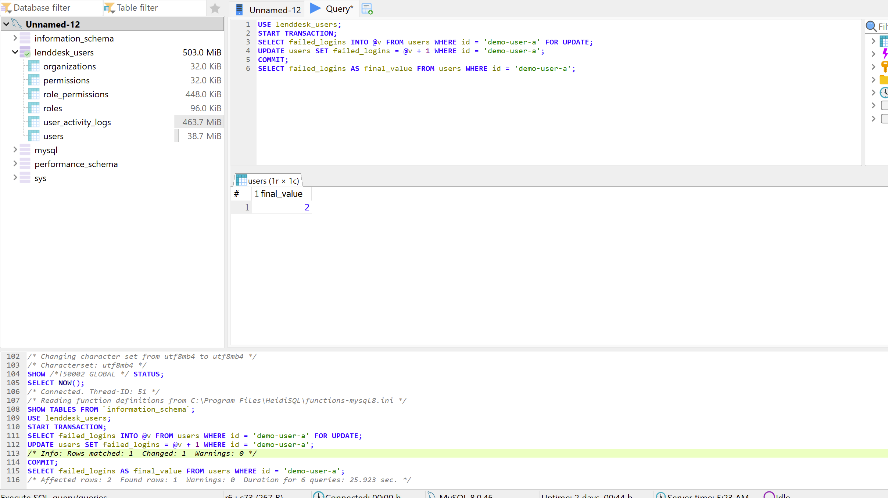
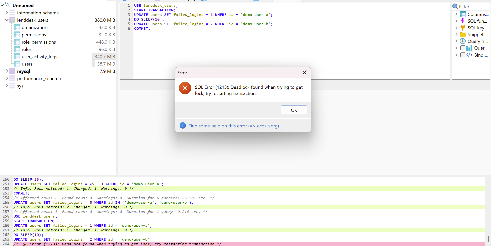

# Portfolio 3: Transactions and Concurrency

**Case study:** LendDesk, a multi-tenant SaaS loan management platform (database `lenddesk_users`).

This portfolio shows how MySQL (InnoDB) keeps data correct when a piece of work fails halfway (commit and rollback), what one transaction can see of another's changes (isolation), and what goes wrong, and how it is controlled, when two users change the same row at the same time (lost update, locking and deadlock).

## 1. Files in this folder

| File | Purpose |
| --- | --- |
| `README.md` | This document |
| `00-setup.sql` | Creates two demo users (`demo-user-a`, `demo-user-b`) in the "Alpha Lending" organization |
| `01-commit-and-rollback.sql` | Part 1: COMMIT and ROLLBACK (one session) |
| `02-dirty-read.sql` | Part 2: isolation level and the dirty read (two sessions) |
| `03-lost-update-and-locking.sql` | Part 3: the lost update and the row lock that fixes it (two sessions) |
| `04-deadlock.sql` | Part 4: a deadlock (two sessions) |
| `99-cleanup.sql` | Removes the demo data |
| `screenshots/` | The HeidiSQL evidence shown below |

The schema comes from Portfolio 1 (`../portfolio-1-database-design/schema.sql`) and the data from Portfolio 2 (`../portfolio-2-query-optimisation/seed-data.py`). All tables use InnoDB, which supports transactions and row-level locking.

## 2. Environment and method

- MySQL 8.0.46 running in a Docker container, queried with HeidiSQL.
- Default isolation level: `REPEATABLE READ`.
- Parts 2 to 4 need two sessions, so I used two separate HeidiSQL windows, called Session A and Session B. Session A runs its script in one go, with a `DO SLEEP(...)` that keeps its transaction open. While it sleeps, Session B runs its statements. The result then appears in one grid.
- The demo users are updated by primary key.

## 3. Setup

`00-setup.sql` removes leftovers from earlier runs and inserts two demo users, `demo-user-a` and `demo-user-b`, both with `failed_logins = 0`.



## 4. Part 1: COMMIT and ROLLBACK (atomicity)

**Commit.** Onboarding a loan officer has to create the user and its audit-log entry together, or not at all. Both inserts ran inside one transaction and were saved with `COMMIT`:

```sql
START TRANSACTION;
INSERT INTO users (...) VALUES (... 'chika.eze@alphalending.com' ...);
INSERT INTO user_activity_logs (user_id, action, status_code) VALUES ('demo-user-c', 'USER_CREATED', 201);
COMMIT;
```

After the commit, the user and its `USER_CREATED` log row are both permanent.



**Rollback.** I then simulated a mistake: an `UPDATE` with no filter beyond the organization that deactivates every user in Alpha Lending.

```sql
START TRANSACTION;
UPDATE users SET is_active = 0
WHERE organization_id = (SELECT id FROM organizations WHERE slug = 'alpha');
ROLLBACK;
```

The active-user count was 945 before, 0 inside the transaction, and 945 again after `ROLLBACK`. The log at the bottom of the screenshot shows the same sequence (1,020 rows matched and 945 changed, then the rollback).



## 5. Part 2: isolation level and the dirty read

The isolation level decides what one transaction may see of another's changes. To show this, Session A changed a value and then undid it, while Session B, set to the weakest level, `READ UNCOMMITTED`, read it in between.

| Step | Session A | Session B (`READ UNCOMMITTED`) |
| --- | --- | --- |
| 1 | `START TRANSACTION;` | `START TRANSACTION;` and read `failed_logins` into `@first` |
| 2 | `UPDATE users SET failed_logins = 9 ...` (not committed) | reads **9** |
| 3 | `ROLLBACK;` | reads again: **0** |

Session B first read **9**, a value that was never committed. After A rolled back, B's second read returned **0**. B had seen data that never officially existed, which is a dirty read.



MySQL's default level, `REPEATABLE READ`, does not allow dirty reads. Weaker levels trade correctness for concurrency.

## 6. Part 3: lost update and its control

**The scenario.** Two failed logins for the same user arrive at the same moment, so `failed_logins` should go from 0 to 2. The application reads the value, adds 1 and writes it back.

**The problem: a lost update.** Both sessions read 0 before either wrote, and both wrote 1. The second write overwrote the first, so the final value was **1 instead of 2**. One update was lost, and neither session received an error.



**The control: `SELECT ... FOR UPDATE`.** The fix is to lock the row when reading it:

```sql
START TRANSACTION;
SELECT failed_logins INTO @v FROM users WHERE id = 'demo-user-a' FOR UPDATE;
UPDATE users SET failed_logins = @v + 1 WHERE id = 'demo-user-a';
COMMIT;
```

Session A took the lock first. Session B's `SELECT ... FOR UPDATE` had to wait about 26 seconds, as the duration in the log shows, until A committed. B then read the new value, added 1 and wrote it. The final value was **2**, which is correct.



An atomic statement, `UPDATE users SET failed_logins = failed_logins + 1 WHERE id = ...`, avoids the problem without a separate read.

## 7. Part 4: deadlock

Each session locked one user and then asked for the other user's row. Each waited for the other, which can never end. MySQL detected the cycle, returned **error 1213** (`Deadlock found when trying to get lock; try restarting transaction`) to one session and rolled that transaction back. The other session then completed.

| Step | Session A | Session B |
| --- | --- | --- |
| 1 | updates `demo-user-a` (holds its lock) | updates `demo-user-b` (holds its lock) |
| 2 | wants `demo-user-b`: waits for B | wants `demo-user-a`: waits for A |
| 3 | one session gets error 1213 and is rolled back; the other finishes | |



## 8. What I learned

- **Atomicity.** A transaction's changes are saved together on `COMMIT` or removed together on `ROLLBACK`, so the user and its audit log are never half written, and a mistaken update can be undone.
- **Isolation.** A weaker level lets one transaction read another's uncommitted work, as the dirty read showed. The default level protects against this.
- **Concurrency control.** Reading a value and writing it back without a lock loses updates silently. A row lock (`FOR UPDATE`) makes the second session wait and then work from the latest value.
- **Deadlocks.** They cannot be fully avoided in a busy system. MySQL resolves them by rolling one transaction back, so the application should retry it. Locking rows in the same order every time, and keeping transactions short, makes them rare.
- **Indexes matter for locking.** An `UPDATE` whose `WHERE` column has no usable index can lock many rows. The demo statements therefore use the primary key.
