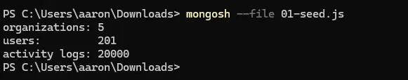
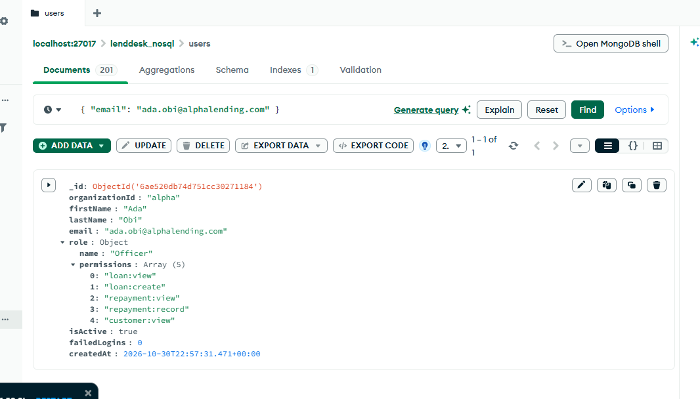
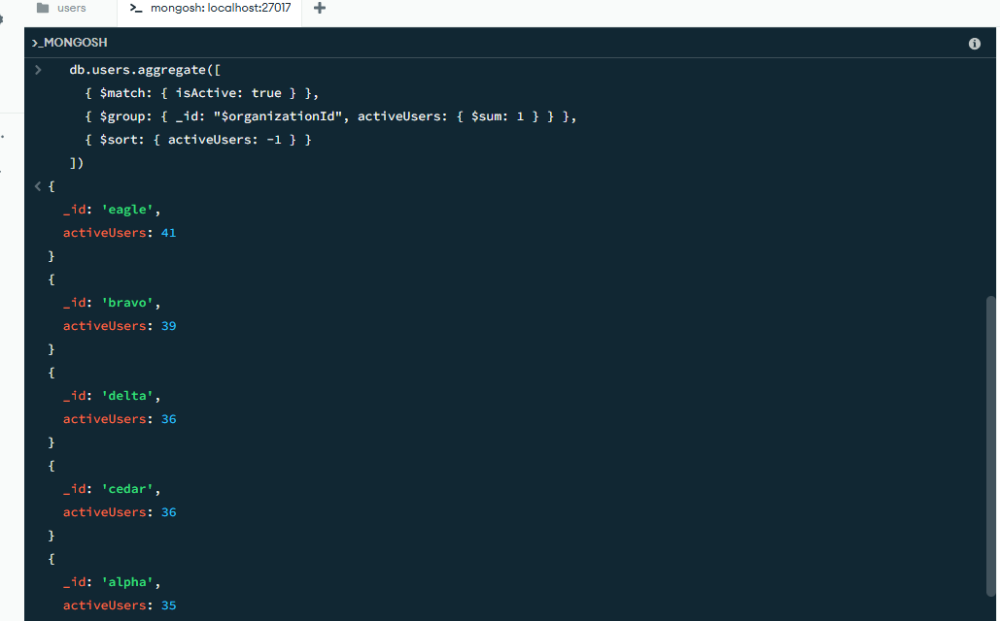
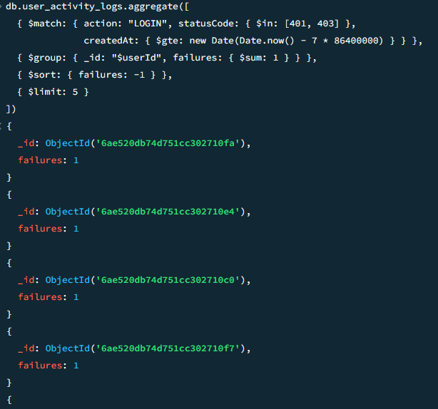
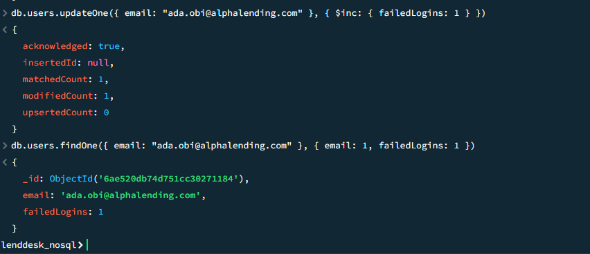
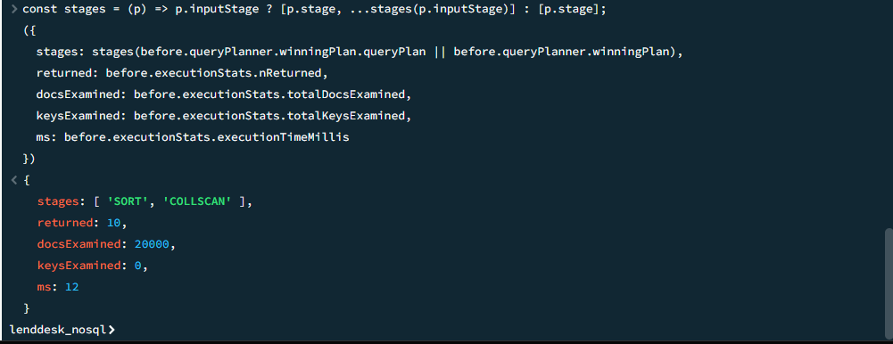
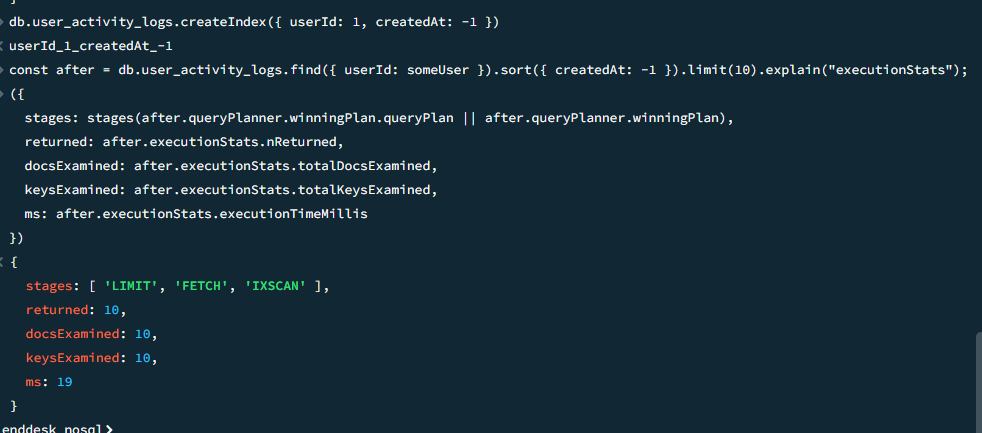

# Portfolio 4: NoSQL and Advanced Data Models

**Case study:** LendDesk, a multi-tenant SaaS loan management platform.
**NoSQL type:** document database, MongoDB 7.0.12 (database `lenddesk_nosql`).
**Scope:** the users, roles, permissions and activity-log data from Portfolios 1 to 3, rebuilt as MongoDB collections.

## 1. Files

| File | Purpose |
| --- | --- |
| [README.md](README.md) | This document |
| [01-seed.js](01-seed.js) | mongosh script that creates the collections and loads generated test data |
| [02-queries.js](02-queries.js) | The queries used in section 4 |
| [screenshots/](screenshots/) | Evidence for section 4, listed in section 5 |

## 2. Environment

MongoDB 7.0.12 installed locally. Queries run in mongosh 2.3.0 (through the MongoDB Compass shell panel); collections inspected in MongoDB Compass. The data is generated by `01-seed.js` and is not real customer data.

Run the seed with `mongosh --file 01-seed.js`. It drops and recreates `lenddesk_nosql` each time.

## 3. Data model

### Relational to document

| MySQL (Portfolios 1 to 3) | MongoDB | Choice |
| --- | --- | --- |
| `organizations` | `organizations` | Own collection |
| `users`, `roles`, `permissions`, `role_permissions` | `users` | Role and permissions embedded in the user |
| `user_activity_logs` | `user_activity_logs` | Own collection, referenced by `userId` |

### Why embed the role, and why keep logs separate

- **Embedded role and permissions.** An authorisation check needs the user and their permissions on every request. In MySQL this is a join across four tables. Here it is one read of one document. Roles change rarely and are read constantly, so duplicating them inside each user is acceptable.
- **Separate activity logs.** A user can accumulate millions of log entries. Embedding them would make the user document grow without limit (MongoDB documents are capped at 16 MB) and slow every read of the user. Each log entry holds `userId` and `organizationId` instead, with an index for lookups.

### Documents

User:

```json
{
  "_id": "ObjectId(...)",
  "organizationId": "alpha",
  "firstName": "Ada",
  "lastName": "Obi",
  "email": "ada.obi@alphalending.com",
  "role": {
    "name": "Officer",
    "permissions": ["loan:view", "loan:create", "repayment:view", "repayment:record", "customer:view"]
  },
  "isActive": true,
  "failedLogins": 0,
  "createdAt": "ISODate(...)"
}
```

Activity log:

```json
{
  "userId": "ObjectId(...)",
  "organizationId": "alpha",
  "action": "LOGIN",
  "statusCode": 401,
  "createdAt": "ISODate(...)"
}
```

Roles and permissions use the same names as the MySQL design (Admin, Manager, Officer, Auditor; `loan:view`, `loan:create` and so on).

## 4. Implementation

### Seed and collections

`01-seed.js` loads 5 organizations, 201 users and 20,000 activity logs.



The same collections in Compass:


### Query 1: one user with all permissions

```js
db.users.findOne({ email: "ada.obi@alphalending.com" })
```

One read returns the user with the role and all five permissions. No join is needed.



### Query 2: active users per organization

```js
db.users.aggregate([
  { $match: { isActive: true } },
  { $group: { _id: "$organizationId", activeUsers: { $sum: 1 } } },
  { $sort: { activeUsers: -1 } }
])
```

Result: eagle 41, bravo 39, delta 36, cedar 36, alpha 35.



### Query 3: failed logins in the last 7 days

```js
db.user_activity_logs.aggregate([
  { $match: { action: "LOGIN", statusCode: { $in: [401, 403] },
              createdAt: { $gte: new Date(Date.now() - 7 * 86400000) } } },
  { $group: { _id: "$userId", failures: { $sum: 1 } } },
  { $sort: { failures: -1 } },
  { $limit: 5 }
])
```

This is the same question as Q2 in Portfolio 2, written as an aggregation pipeline. Each user in the result has one failure in the window.



### Query 4: atomic update

```js
db.users.updateOne({ email: "ada.obi@alphalending.com" }, { $inc: { failedLogins: 1 } })
```

`$inc` reads and increments the value inside the database as one operation on one document, so two concurrent increments cannot overwrite each other. This is the safe form of the lost-update case from Portfolio 3. Result: `matchedCount: 1`, `modifiedCount: 1`, then `failedLogins: 1`.



### Query 5: index and query plan

The latest 10 activity entries for one user, with `explain("executionStats")` before and after creating an index.

```js
const someUser = db.users.findOne({ email: "ada.obi@alphalending.com" })._id;
const before = db.user_activity_logs.find({ userId: someUser }).sort({ createdAt: -1 }).limit(10).explain("executionStats");

db.user_activity_logs.createIndex({ userId: 1, createdAt: -1 })

const after = db.user_activity_logs.find({ userId: someUser }).sort({ createdAt: -1 }).limit(10).explain("executionStats");
```

| | Before the index | After the index |
| --- | --- | --- |
| Plan stages | `SORT`, `COLLSCAN` | `LIMIT`, `FETCH`, `IXSCAN` |
| Documents examined | 20,000 | 10 |
| Index keys examined | 0 | 10 |
| Documents returned | 10 | 10 |

Without the index MongoDB scanned the whole collection and sorted the matches. With it, MongoDB reads the user's entries in date order from the index and stops after 10, so no sort is needed. The measured run times (12 ms before, 19 ms after) are too small to compare on 20,000 documents, and the first query after creating an index can be slower while the server warms up. Documents examined is the figure that grows with the collection, so it is the one that shows the effect. The index puts the equality field (`userId`) before the sort field (`createdAt`), the same rule used in Portfolio 2.




## 5. Screenshot index

| File | Shows |
| --- | --- |
| [00-compass-collections.png](screenshots/00-compass-collections.png) | The three collections and their document counts in Compass |
| [01-seed-output.png](screenshots/01-seed-output.png) | Seed script output: 5, 201 and 20,000 documents |
| [02-user-document.png](screenshots/02-user-document.png) | Query 1: user with embedded role and permissions |
| [03-users-per-org.png](screenshots/03-users-per-org.png) | Query 2: active users per organization |
| [04-failed-logins.png](screenshots/04-failed-logins.png) | Query 3: failed logins, last 7 days |
| [05-atomic-update.png](screenshots/05-atomic-update.png) | Query 4: `$inc` update and the result |
| [06-explain-before.png](screenshots/06-explain-before.png) | Query 5 before the index: `SORT`, `COLLSCAN`, 20,000 documents examined |
| [07-explain-after.png](screenshots/07-explain-after.png) | Query 5 after the index: `IXSCAN`, 10 documents examined |

## 6. Suitability for LendDesk

**Where a document model fits**
- Reading a user with permissions is a single-document read, which is what an authorisation check needs on every request.
- Lenders can store extra fields on a user or an activity entry (a mobile-money reference, for example) without a schema migration.
- Activity logs are written constantly and read by user and time. This suits a document store, and a large collection can be spread across servers by sharding.
- Updating one document, including its embedded role, is atomic without an explicit transaction.

**Where it does not fit as well**
- A role's permissions are copied into every user who holds that role. Changing a role means updating many documents, and a missed one leaves a user with stale permissions. In MySQL the role is stored once.
- MongoDB does not enforce foreign keys or `CHECK` constraints the way MySQL does, so rules such as "failed logins cannot be negative" must be enforced by the application or by schema validation.
- Work that must change several records together, such as moving funds between loans or accounts, belongs in MySQL transactions (Portfolio 3), although MongoDB also supports multi-document transactions.

**Other NoSQL types considered (not implemented)**

| Type | Possible use in LendDesk |
| --- | --- |
| Key-value (Redis) | Login sessions and a per-user failed-login counter with an expiry |
| Column-family (Cassandra) | Very large, write-heavy activity logs partitioned by time |
| Graph (Neo4j) | Access paths through roles, teams and organizations |

I implemented the document model because it fits the user and access-control data best.

## 7. Conclusion

A document database stores related data together so it can be read in one step, which makes reads simpler and moves the cost to updates of shared data. Embedding or referencing depends on how the data is read and how fast it grows. That is why the role is embedded in the user and the activity logs are not. For LendDesk, MongoDB suits user lookups and the log collection, and MySQL stays the better home for the financial records that need strict integrity.
